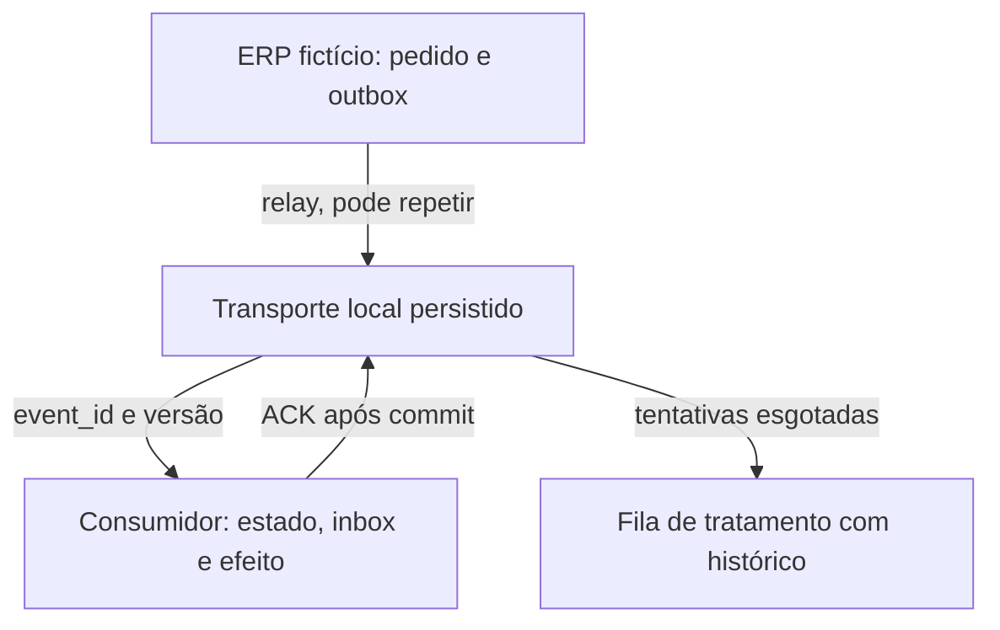

# ERP e Satélites Lab

**Um evento repetido não deveria repetir o efeito de negócio.**

Laboratório autoral de [Jeferson Resende](https://www.gruporsd.com.br/), com Python e SQLite, para demonstrar decisões de confiabilidade em integrações. Todos os pedidos e eventos são fictícios. Não usa SAP, SQS, credenciais ou dados de clientes.

## Reproduza em três comandos

Requisito: **Python 3.10 ou superior**. Nenhuma instalação de pacote, conta ou serviço pago.

```bash
python --version
python -m unittest discover -s tests -v
python lab.py demo --output evidence/minha-execucao.json
```

No Windows, `py` pode substituir `python`. Execute os comandos na pasta deste README. A demonstração padrão usa uma pasta temporária e grava apenas o JSON solicitado. O relatório incluído em `evidence/demo.json` foi gerado pelo programa; execute novamente para conferir.

Para inspecionar os três bancos localmente:

```bash
python lab.py demo --directory .runtime --output evidence/minha-execucao.json
python lab.py clean --directory .runtime
```

`demo` recusa bancos já existentes. `clean` exige o marcador do laboratório e remove somente `erp.db`, `consumer.db`, `transport.db` e esse marcador; outros arquivos são preservados.

## O que observar

| Entrega | Situação | Resultado |
|---|---|---|
| 1 | Pedido criado, versão 1 | `applied` |
| 2 | Envio, versão 2; falha depois do commit, antes do ACK | Estado gravado; entrega permanece pendente |
| 2 repetida | Consumidor aberto novamente | `duplicate`; nenhum novo efeito |
| 3 | Cancelamento, versão 3 | `applied` |
| 4 | Evento antigo com outro ID, versão 1 | `stale`; pedido continua cancelado |

Estado esperado: pedido `pedido-demo-001` **CANCELLED**, versão **3**, com **3 efeitos locais** no total (criação, envio e cancelamento). O efeito de envio aparece **uma vez**, embora sua entrega tenha sido tentada duas vezes.

## Arquitetura e decisões



Cada componente tem seu próprio arquivo SQLite. Nenhuma transação abrange dois bancos.

- [ADR 001: outbox e entrega repetida](docs/ADR-001.md).
- [ADR 002: efeito local e deduplicação na mesma transação](docs/ADR-002.md).
- [Contrato do evento](docs/event.schema.json).
- [Roteiro de revisão independente](docs/REVISAO.md).

## Critérios testados

Os 14 testes cobrem: 16 entregas concorrentes do mesmo evento; rollback antes do commit; falha depois do commit antes do ACK; reabertura em **outro processo**; atomicidade do produtor; repetição no relay; evento antigo; lacuna de versão e recuperação; reutilização indevida de ID; conflito de versão; cancelamento terminal; contrato inválido e fila de tratamento; replay preservando identidade; validação de tipo; reconciliação da demonstração.

O executor de testes é a referência da contagem. Duração em um computador não representa benchmark de desempenho.

## Mudança de contrato e limite do rollback

A extensão publicada em 09/11 acrescenta **seis testes**, totalizando **20** na suíte atual. Os 14 critérios acima continuam sendo os do módulo de eventos. O ZIP v1 no artigo corresponde ao lançamento original; esta extensão está na versão atual deste repositório.

```bash
python change_lab.py demo --output evidence/minha-mudanca.json
```

A simulação expande um contrato fictício, preenche a nova coluna e grava nas duas representações durante a janela de compatibilidade. Voltar a aplicação preserva dois pedidos. O snapshot anterior contém apenas um: reaplicá-lo exigiria recuperar e reconciliar a escrita posterior. Depois de remover o contrato legado, o retorno à aplicação antiga é bloqueado.

- [ADR 003: compatibilidade e recuperação de dados](docs/ADR-003.md).
- [Roteiro de sessão de 15 minutos](docs/SESSAO-15MIN.md).
- [Resultado executado](evidence/change-demo.json).

Não executa rollback em sistemas reais, restauração operacional, efeitos externos, canário com tráfego ou medição de RTO/RPO. A troca de versão é uma flag no processo; o snapshot é local e sua diferença é inspecionada, sem restauração automática.

## Limites que fazem parte da decisão

- É uma simulação local, sem rede, broker real, leases, visibility timeout ou garantias de disponibilidade.
- SQLite serializa a escrita com `BEGIN IMMEDIATE`; isso demonstra atomicidade e concorrência local, não escalabilidade distribuída.
- A deduplicação só protege o efeito gravado no **mesmo banco** do consumidor. Uma chamada HTTP, PIX, e-mail ou outro efeito externo exige estratégia própria de idempotência/reconciliação.
- Não promete exactly-once de ponta a ponta. O transporte pode entregar novamente; o consumidor impede a repetição do efeito local dentro do escopo testado.
- A versão pertence ao pedido e deve ser emitida de forma consistente pela origem. Timestamp sozinho não define ordem de negócio.
- Evento antigo recebe descarte auditado; lacuna de versão pede recuperação. São regras deste laboratório, não políticas universais.
- A fila de tratamento preserva falhas e permite replay com o mesmo `event_id`. A causa deve ser corrigida antes de reprocessar.
- Não há expiração automática da inbox. Retenção, crescimento e replay histórico precisam ser definidos antes de qualquer aplicação real.
- Não há revisão externa concluída, homologação de cliente, SLA ou economia financeira comprovada.

## Leia e compartilhe

- [Artigo completo: idempotência em integrações ERP](https://www.gruporsd.com.br/artigos/idempotencia-em-integracoes-erp/).
- [Portfólio profissional](https://www.gruporsd.com.br/portfolio/).
- [LinkedIn de Jeferson Resende](https://www.linkedin.com/in/jresendejr/).

Encontrou um cenário de falha que ficou de fora? Abra uma issue com passos de reprodução e resultado esperado, usando apenas dados fictícios. Não envie credenciais, logs privados ou dados de clientes.

## Referências

- [AWS — Transactional outbox](https://docs.aws.amazon.com/prescriptive-guidance/latest/cloud-design-patterns/transactional-outbox.html).
- [Microsoft — Idempotent Consumer](https://learn.microsoft.com/en-us/azure/architecture/patterns/idempotent-consumer).
- [SQLite — Transactions](https://www.sqlite.org/lang_transaction.html).

## Autoria e licença

Jeferson Resende. Desenvolvimento com assistência de IA, revisão e testes automatizados documentados. Este laboratório não representa AtisWork, CPFL Energia ou qualquer cliente. Licença de reutilização ainda não definida pelo autor; nenhum direito de terceiros foi incluído no projeto.
